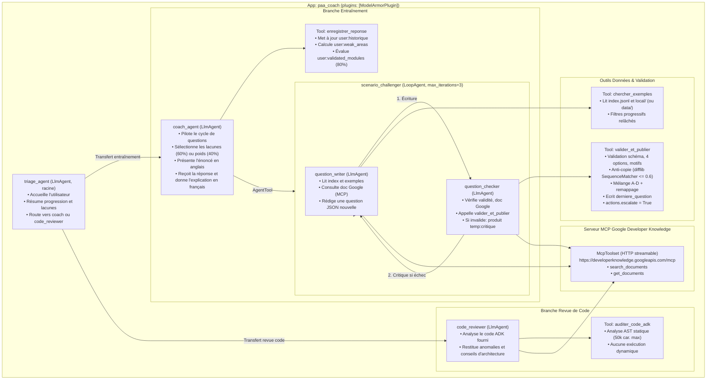
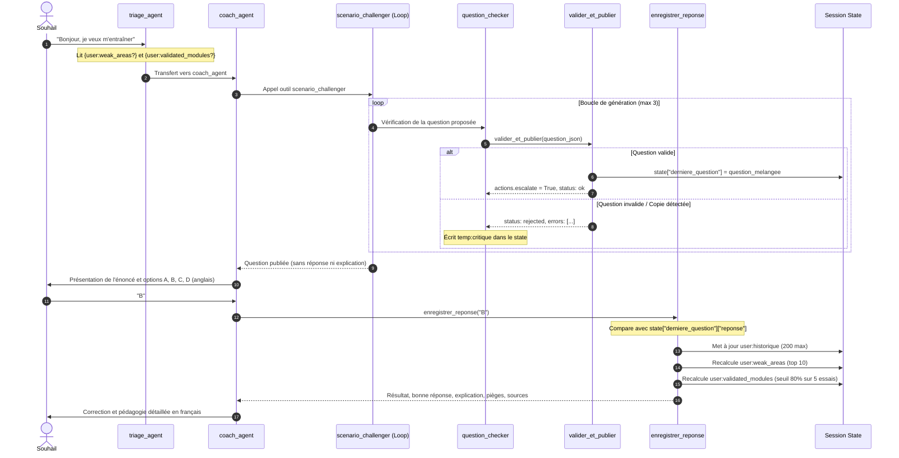

# Architecture de paa-coach

Ce document décrit l'architecture multi-agents, le cycle de vie des données (state), les outils sur mesure et les conclusions de l'essai minimal (Critère 0 du § 9 de la spécification).

---

## 1. Essai minimal (Critère 0) — Résultats et arbitrages

L'essai minimal a testé et tranché les points d'intégration critiques d'ADK 2.13.0 avant le développement complet.

### 1.1 Chargement de `app` et de ses plugins par `adk web`
- **Source vérifiée** : Code source installé de `google.adk.cli.utils.agent_loader` (`AgentLoader._perform_load` et `_load_from_submodule`) et `google.adk.cli.api_server` (`get_runner_async`).
- **Comportement constaté** :
  1. `AgentLoader` inspecte d'abord l'attribut `app` dans `{nom_agent}.agent` ou `{nom_agent}`. Si cet attribut est une instance de `google.adk.apps.App`, il le renvoie directement.
  2. Dans `api_server.py` (utilisé par `adk web`), `if isinstance(agent_or_app, App):` conserve l'application telle quelle, concatène les plugins configurés (`agent_or_app.plugins + extra_plugins_instances`) et transmet l'instance à `_create_runner`.
- **Verdict** : **Confirmé**. Exposer `app = App(name="paa_coach", root_agent=root_agent, plugins=[...])` dans `paa_coach/agent.py` active nativement les plugins (notamment `ModelArmorPlugin`) dans `adk web`.

### 1.2 Visibilité du state à travers `AgentTool`
- **Source vérifiée** : Code source installé de `google.adk.tools.agent_tool.AgentTool.run_async` et test d'exécution automatisé.
- **Comportement constaté** :
  1. Lorsqu'un outil appelé à l'intérieur de la sous-exécution (ex. `valider_et_publier` dans `question_checker`) modifie l'état via `tool_context.state["derniere_question"] = ...`, le runner de la sous-exécution émet un événement ADK portant `actions.state_delta`.
  2. `AgentTool.run_async` intercepte chaque événement du runner interne et exécute :
     ```python
     if event.actions.state_delta:
         tool_context.state.update(event.actions.state_delta)
     ```
  3. L'état est ainsi propagé directement dans le `ToolContext` du parent (`coach_agent`) et persisté dans la session appelante.
  4. L'arrêt de la boucle `LoopAgent` est assuré par `tool_context.actions.escalate = True` dans `valider_et_publier`.
- **Stratégie retenue** :
  - **Mécanisme principal** : `valider_et_publier` écrit la question validée dans `tool_context.state["derniere_question"]` et lève `actions.escalate = True`.
  - **Sécurité et robustesse (repli actif)** : `valider_et_publier` renvoie également la question validée dans son dictionnaire de retour (`{"status": "ok", "question": {...}}`). Le sous-agent la renvoie en texte, ce qui permet à `coach_agent` d'en disposer à la fois dans son state de session et dans la valeur de retour directe de l'outil.

---

## 2. Schéma global d'architecture



---

## 3. Schéma du cycle de vie du State



---

## 4. Organisation des clés de State

| Clé | Portée | Type | Description |
|---|---|---|---|
| `derniere_question` | Session | `dict` | Question en cours (options mélangées, bonne réponse, explication, pièges). Remplacée à chaque nouvelle question. |
| `temp:critique` | Invocation | `str` | Retour d'erreur de `question_checker` vers `question_writer` lors d'une itération de rejet. |
| `user:historique` | Persistant (`user:`) | `list[dict]` | Historique chronologique des 200 dernières tentatives (`id`, section, motifs, résultat `juste`/`faux`). |
| `user:weak_areas` | Persistant (`user:`) | `list[dict]` | Top 10 des sections et motifs les plus échoués, avec compteurs d'échecs. |
| `user:validated_modules` | Persistant (`user:`) | `list[str]` | Liste des sections validées (au moins 5 tentatives et >= 80% de réussite sur les 5 dernières). |

---

## 5. Composants de sécurité et observabilité

1. **Model Armor (`ModelArmorPlugin`)** :
   - Branché au niveau de `App` via `PAA_MODEL_ARMOR_PROMPT_TEMPLATE` et `PAA_MODEL_ARMOR_RESPONSE_TEMPLATE`.
   - Filtre les injections de prompt (dans les inputs utilisateur et le code soumis) et prévient les fuites de données.
2. **Contrôle d'accès Cloud Run** :
   - Déploiement avec `--no-allow-unauthenticated` et `--iap`.
   - Rôle IAM `roles/iap.httpsResourceAccessor` réservé à `PAA_ALLOWED_MEMBER`.
   - Compte de service dédié `paa-coach-run` avec principe de moindre privilège.
3. **Observabilité** :
   - Traces OpenTelemetry exportées vers Cloud Trace via `--otel_to_cloud` / `--trace_to_cloud`.
